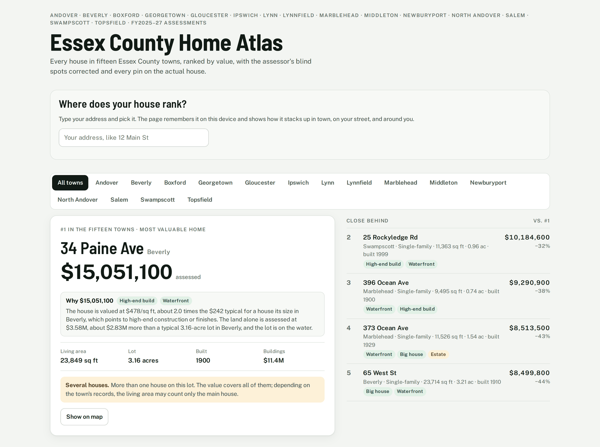
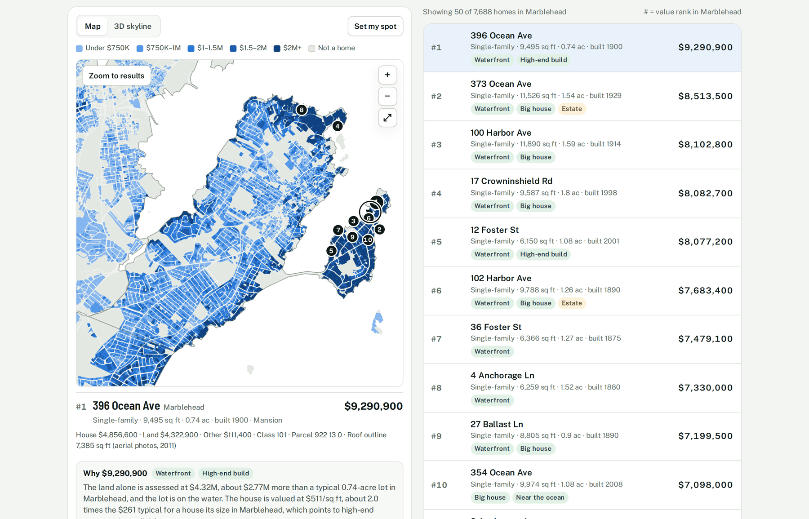
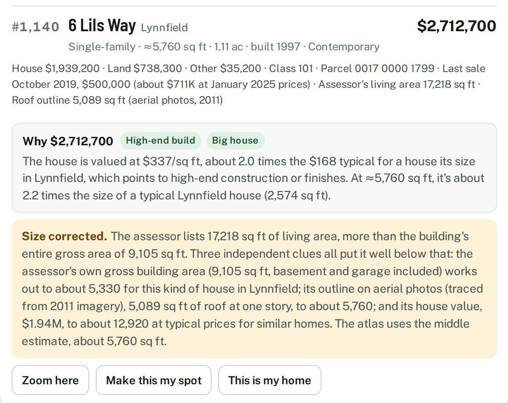
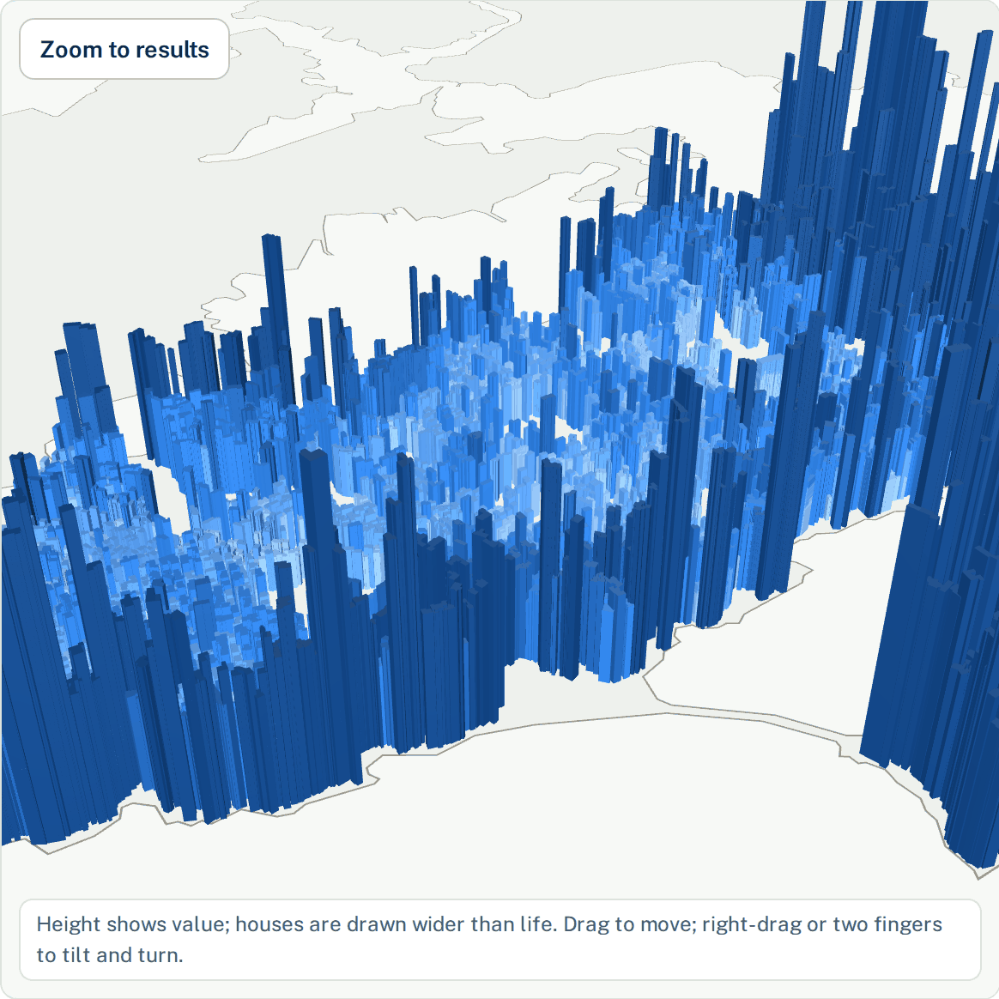
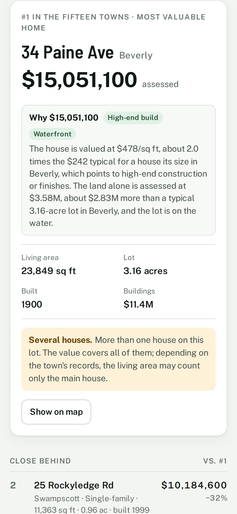
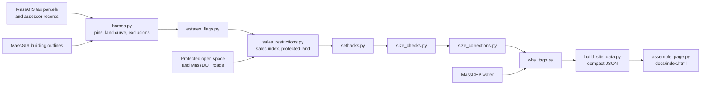

# Essex County Home Atlas

**Every home in 15 North Shore Massachusetts towns, ranked by value, with the blind spots in the assessor data found and corrected.**

### [Open the live atlas →](https://astefanidis1.github.io/essex-county-home-atlas/)



113,502 homes in Andover, Beverly, Boxford, Georgetown, Gloucester, Ipswich, Lynn, Lynnfield, Marblehead, Middleton, Newburyport, North Andover, Salem, Swampscott and Topsfield, built entirely from public state data. No listing sites are scraped, and no owner names are downloaded or shown.

## What it does

- **Ranks every home by corrected value**, region-wide and town by town, with records (biggest house, oldest home, priciest street) and collections (hidden estates, mansions, new big builds, recent sales).
- **Explains every $1M+ home in a tag or two:** *Waterfront*, *Big house*, *Acreage*, *Prime location*, *High-end build*, *Historic*, and so on, backed by a one-line breakdown of where the value sits.
- **Flags and fixes assessor errors**, and says so in plain English on each home: what the record says, what the evidence says, and what the atlas uses instead.
- **Maps it all:** every lot shaded by value, pins on the actual house rather than the barn or the middle of the yard, a 3D skyline where height is value, and a "where does my house rank" panel that remembers your home.

## The interesting part: assessor data is full of traps

Assessed values are public and easy to download, and quietly wrong in ways that break a naive ranking. Each of these turned up while building the atlas, and each is detected and handled in the pipeline.

| Trap | What it looks like | How the atlas handles it |
|---|---|---|
| **Apartment blocks coded as homes** | Lynn codes about a hundred mixed-use apartment buildings the same way as a house with a home business, including a 10-story, $100M tower that would otherwise be the region's #1 "home." | Excluded by building style and size. So are apartment blocks Salem and Gloucester code as "multiple houses," and a $27.6M Marblehead parcel with 30+ buildings recorded as one "home." |
| **Farm and forest land** | Land in the Chapter 61/61A/61B programs is assessed at its use value, far below market. | Re-valued from a per-town land-value curve by lot size, and labeled "Land corrected." |
| **Land that really is cheap** | A permanent conservation restriction makes low land value real. | Spatial join with the state's protected open space map; those lots are never re-valued. |
| **Living areas that don't add up** | A Lynnfield house is recorded at 17,218 sq ft, more than the building's own gross area. | Three independent estimates (gross area, aerial outline × stories, house value ÷ typical $/sq ft), each calibrated by town and house type. A size is corrected only when they agree: that house becomes ≈5,760 sq ft. |
| **A town filing gross area as living area** | Salem's "living area" averages about 460 sq ft per room against about 300 elsewhere: it counts basements, attics and porches. | Living area is estimated from living-to-gross ratios learned in the towns that record both (about 59% on average), and marked ≈. |
| **Bulk transfers posing as sales** | 64 Ipswich cottages "sold" on one day in 2012 for about $180K each, as owners bought land shares in a condo conversion. | Same-day transfers of 25+ parcels are dropped from the sales index. |
| **Assessments behind the market** | A home sold for $8.5M against a $6.39M assessment. | Each town gets a year-by-year sales index. Recent sales well above the assessment, and sales of homes whose assessment is known to be off, are adjusted to the valuation date and used. |
| **Houses assessed mid-construction** | A new house valued at a fraction of its finished worth. | Valued as finished at the town's recent-build $/sq ft, marked ≈. |
| **Pins in the wrong place** | Parcel centroids land in the yard, on a barn, or in the neighbor's lot when lot lines cut through a house. | Each home is matched to the building outline that fits its recorded size, kept on the part of the house inside its own lot. |
| **Different valuation dates** | Marblehead is valued a year earlier (Jan 2024), and Beverly and Swampscott a year later (Jan 2026), than the rest. | Stated on every town page and in the cross-town comparison. |

*Waterfront* comes from MassDEP hydrography: the lot has to touch the ocean, a harbor, a river, or a pond of 5+ acres with no road in between.

## Screens



| A corrected home, explained | 3D skyline: height is value |
|---|---|
|  |  |

<p align="center"></p>

## How it works



- **Pipeline** (`pipeline/`): Python with pandas, NumPy, Shapely and requests. Each step reads the previous step's output from `data/` and prints diagnostics, so every correction can be traced.
- **Why tags**: each $1M+ home's value is split into land (what a lot that size usually carries in town, plus anything above that for location) and house (what a house that size usually carries, plus anything above that for build quality). The biggest part names the tag.
- **Site** (`docs/`): one static page with no framework or build step. Vanilla JavaScript draws the lot map on a canvas, switching between per-home squares and full lot lines as you zoom. deck.gl loads on demand for the 3D view. Data ships as gzip-compressed JSON: a 3.6 MB index of every home, with lot lines and building footprints lazy-loaded per town.
- **Page source** (`web/`): the head, body and script that `assemble_page.py` stitches into `docs/index.html`.

## Checks

- Each town's top home-coded records on the live MassGIS server are cross-checked against the site data (`pipeline/checks/verify_against_server.py`). In the latest run, every one in the atlas matched its assessed value exactly. The rest were deliberate exclusions: mixed-use apartment and commercial buildings, condo records covering a whole building, and the multi-building Marblehead parcel.
- The same run checked 1,345 pins (the top 60 overall plus 90 in each town) against the state's parcel map, and all 1,345 sit inside their own lot.
- Rerunning the cleaned-up pipeline from the raw downloads reproduces the published site data exactly.
- Flagged and corrected homes were spot-checked on 2025 aerial imagery with the lot and building outlines drawn on top (`pipeline/checks/chiplib.py`).

## Run it yourself

```bash
pip install -r requirements.txt
python pipeline/run_all.py               # downloads ~200 MB from MassGIS, processes it, rebuilds docs/
python pipeline/run_all.py --skip-fetch  # reprocess using the downloads already in data/
cd docs && python -m http.server         # then open http://localhost:8000
```

To add a town, append it to `TOWNS` and `TID` in `pipeline/towns.py` (the ID is MassGIS's `TOWN_ID`). For a quick ranked CSV of any Massachusetts town, there's also `python pipeline/town_home_values.py "North Andover"`.

## Data and caveats

- [MassGIS Property Tax Parcels](https://www.mass.gov/info-details/massgis-data-property-tax-parcels): lot lines and the assessor's records
- [MassGIS Building Structures (2-D)](https://www.mass.gov/info-details/massgis-data-building-structures-2-d): building outlines
- [MassGIS Protected and Recreational OpenSpace](https://www.mass.gov/info-details/massgis-data-protected-and-recreational-openspace): conservation restrictions
- [MassGIS-MassDOT Roads](https://www.mass.gov/info-details/massgis-data-massgis-massdot-roads): road centerlines
- [MassDEP Hydrography (1:25,000)](https://www.mass.gov/info-details/massgis-data-massdep-hydrography-125000): water bodies and rivers

Assessed values are not appraisals or sale prices. Every estimate is marked ≈ and explained on the home's card. Valuation dates differ by town (fiscal 2025 to 2027).

## Credits

Built by Alexandros Stefanidis, with [Claude](https://claude.ai) (Anthropic) as an AI coding partner. Code under the [MIT license](LICENSE); the property data belongs to the Commonwealth of Massachusetts.
